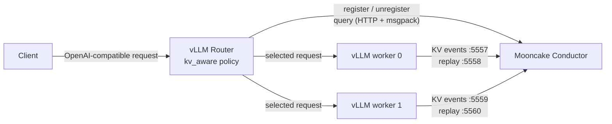

# Conductor Quick Start: vLLM and Cache-Aware Routing

This guide builds an end-to-end setup with two vLLM workers, one Mooncake
Conductor, and vLLM Router. It follows
[vLLM Router PR #528](https://github.com/vllm-project/router/pull/528) at
revision
[`2a14f0b`](https://github.com/vllm-project/router/tree/2a14f0b9b2d35d08d4c89ebd66f62c5bd9abeb4c)
and the design in
[RFC #414](https://github.com/vllm-project/router/issues/414).

```{warning}
The Router integration is experimental and the referenced PR was still a work
in progress when this guide was written. The `--conductor-*` options below are
specific to that PR revision, not options guaranteed to exist in a released
Router. Check the PR for its current status and flag names. The RFC also
contains later design items; this guide uses only the PR revision's `local` and
`conductor` backends and its HTTP/MessagePack transport.
```

## What you will build



Conductor reports cache locality; Router still owns worker discovery, health,
load accounting, and the final routing decision. If Conductor cannot be queried,
the PR's Router integration degrades placement to load-only scoring instead of
failing the inference request.

The example uses vLLM device-cache events only. It does not require Mooncake
Store.

## Prerequisites

- A Linux machine with two compatible GPUs. To use one GPU, run one worker and
  omit the second worker URL and event sources below.
- The same model files available to both workers. This guide uses the served
  model name `demo-model`.
- A vLLM build that supports `--kv-events-config`,
  `--prefix-caching-hash-algo sha256_cbor`, and token-array prompts.
- Mooncake's C++ build dependencies, CMake, and a C++20 compiler.
- Cargo and a Rust toolchain for Router.
- Python 3 with the `msgpack` package for inspecting Conductor:

  ```bash
  python3 -m pip install msgpack
  ```

All workers serving one cache context must use the same model, block size,
prefix-hash algorithm, and `PYTHONHASHSEED`. This guide explicitly sets all of
them so Conductor can reproduce vLLM's block hashes.

## 1. Build Conductor

Run from the Mooncake repository root:

```bash
cmake -S . -B build -DWITH_CONDUCTOR=ON
cmake --build build --target mooncake_conductor --parallel
```

Create an empty service configuration. Router will register the workers
dynamically:

```bash
cat > /tmp/conductor.json <<'JSON'
{
  "http_server_port": 13333,
  "rpc_server_port": 13334,
  "max_blocks_per_context": 200000,
  "kvevent_instance": {}
}
JSON
```

Start Conductor in its own terminal:

```bash
CONDUCTOR_CONFIG_PATH=/tmp/conductor.json \
CONDUCTOR_LOG_LEVEL=info \
  ./build/mooncake-conductor/mooncake_conductor
```

Keep this process running. The HTTP API is now on `127.0.0.1:13333`; the native
RPC API is on `127.0.0.1:13334`.

## 2. Build the Router PR revision

In a separate workspace, check out the exact revision used by this guide and
build the default HTTP/MessagePack transport:

```bash
git clone https://github.com/vllm-project/router.git
cd router
git fetch origin pull/528/head
git checkout 2a14f0b9b2d35d08d4c89ebd66f62c5bd9abeb4c
cargo build --release
```

The resulting executable is `target/release/vllm-router`. No Mooncake C++
library is linked into Router for this default HTTP build.

## 3. Start two vLLM workers

Set `MODEL` to a local model path or a model identifier available in your vLLM
environment. Use a separate terminal for each worker and set `MODEL` in both.

Worker 0, using GPU 0:

```bash
export MODEL=/path/to/model
export PYTHONHASHSEED=0
CUDA_VISIBLE_DEVICES=0 vllm serve "$MODEL" \
  --served-model-name demo-model \
  --host 127.0.0.1 \
  --port 8000 \
  --block-size 16 \
  --enable-prefix-caching \
  --prefix-caching-hash-algo sha256_cbor \
  --kv-events-config '{
    "enable_kv_cache_events": true,
    "endpoint": "tcp://127.0.0.1:5557",
    "replay_endpoint": "tcp://127.0.0.1:5558",
    "topic": ""
  }'
```

Worker 1, using GPU 1:

```bash
export MODEL=/path/to/model
export PYTHONHASHSEED=0
CUDA_VISIBLE_DEVICES=1 vllm serve "$MODEL" \
  --served-model-name demo-model \
  --host 127.0.0.1 \
  --port 8001 \
  --block-size 16 \
  --enable-prefix-caching \
  --prefix-caching-hash-algo sha256_cbor \
  --kv-events-config '{
    "enable_kv_cache_events": true,
    "endpoint": "tcp://127.0.0.1:5559",
    "replay_endpoint": "tcp://127.0.0.1:5560",
    "topic": ""
  }'
```

The endpoints above are the addresses on which each vLLM publisher binds and on
which Conductor connects. In a multi-host deployment, replace them with
addresses reachable from Conductor; do not register wildcard addresses such as
`tcp://*:5557`. Each worker needs unique PUB and replay ports.

Wait until both workers are healthy:

```bash
curl --fail http://127.0.0.1:8000/health
curl --fail http://127.0.0.1:8001/health
```

## 4. Start Router with Conductor

Run from the Router checkout:

```bash
./target/release/vllm-router \
  --host 127.0.0.1 \
  --port 30000 \
  --worker-urls http://127.0.0.1:8000 http://127.0.0.1:8001 \
  --policy kv_aware \
  --kv-index-backend conductor \
  --conductor-transport http \
  --conductor-url http://127.0.0.1:13333 \
  --conductor-hash-strategy vllm_v1 \
  --conductor-hash-algorithm sha256_cbor \
  --conductor-hash-index-projection low64_be \
  --conductor-hash-python-seed 0 \
  --kv-event-model demo-model \
  --kv-event-block-size 16 \
  --kv-event-source http://127.0.0.1:8000=tcp://127.0.0.1:5557 \
  --kv-event-replay-source http://127.0.0.1:8000=tcp://127.0.0.1:5558 \
  --kv-event-source http://127.0.0.1:8001=tcp://127.0.0.1:5559 \
  --kv-event-replay-source http://127.0.0.1:8001=tcp://127.0.0.1:5560
```

The static `--kv-event-source` mappings make this example independent of
optional engine control-plane endpoints. The Nth comma-separated endpoint for a
worker represents DP rank N; this example has one rank per worker.

Router registration is enabled by default. The PR also renews registrations
periodically. Identical renewal requests are idempotent on Conductor. To use an
external registration controller instead, add `--no-conductor-register` and
register the sources yourself.

The most important initial options are:

| Option | Value in this guide |
|---|---|
| `--kv-index-backend` | `conductor`, instead of Router's default `local` index |
| `--conductor-url` | Conductor HTTP base URL, without `/query` |
| `--conductor-query-timeout-ms` | `10` by default; the request-path placement budget |
| `--conductor-hash-*` | Must match the workers' actual hash configuration |
| `--kv-event-model` | `demo-model`, matching `--served-model-name` |
| `--kv-event-block-size` | `16`, matching `--block-size` |

## 5. Inspect registration and the empty index

Save this small MessagePack client outside the source trees:

```bash
cat > /tmp/conductor_query.py <<'PY'
import json
from urllib.request import Request, urlopen

import msgpack

BASE = "http://127.0.0.1:13333"

with urlopen(BASE + "/services", timeout=3) as response:
    services = msgpack.unpackb(response.read(), raw=False)
print("SERVICES")
print(json.dumps(services, indent=2))

body = {
    "model": "demo-model",
    "block_size": 16,
    "token_ids": list(range(1, 65)),
}
request = Request(
    BASE + "/query",
    data=msgpack.packb(body),
    headers={"Content-Type": "application/msgpack"},
    method="POST",
)
with urlopen(request, timeout=3) as response:
    result = msgpack.unpackb(response.read(), raw=False)
print("QUERY")
print(json.dumps(result, indent=2))
PY

python3 /tmp/conductor_query.py
```

After Router discovers and registers both workers, `SERVICES` should contain
two vLLM entries, one for each worker and DP rank. Use the actual `InstanceID`
values in this response when comparing logs; do not assume they are the worker
hostnames.

Before any matching request, `QUERY.instances` is either empty or contains the
registered instances with zero hit counts. Both are valid empty-cache states.
If `SERVICES.count` remains zero, inspect Router registration logs and check
that the hash profile and endpoints shown above match the workers.

## 6. Send a request twice and verify cache locality

Use a token-array prompt so both Router and vLLM see the exact same 64 token IDs
without depending on chat templates or tokenizer calls:

```bash
python3 - <<'PY'
import json

request = {
    "model": "demo-model",
    "prompt": list(range(1, 65)),
    "max_tokens": 1,
    "temperature": 0,
}
with open("/tmp/conductor-request.json", "w") as output:
    json.dump(request, output)
PY

curl --silent --show-error --fail \
  http://127.0.0.1:30000/v1/completions \
  -H 'Content-Type: application/json' \
  --data @/tmp/conductor-request.json

curl --silent --show-error --fail \
  http://127.0.0.1:30000/v1/completions \
  -H 'Content-Type: application/json' \
  --data @/tmp/conductor-request.json
```

The first request populates complete KV blocks on whichever healthy worker
Router selects. On the second request, Router queries Conductor once for all
registered instances and gives the worker reporting the reusable prefix the
corresponding placement credit. Load, health, and the Router's cost model still
affect the final choice; Conductor does not force a target.

Inspect the index again:

```bash
python3 /tmp/conductor_query.py
```

At least one instance should now report nonzero counts. With the exact 64-token
prompt and block size 16, a fully indexed hit has this shape (the instance ID
may differ):

```json
{
  "instances": {
    "<worker-instance-id>": {
      "longest_matched": 64,
      "device": 64,
      "cpu_local": 64,
      "cpu_share": 64,
      "disk": 64
    }
  }
}
```

The actual response also contains `dp` and `rank_matches`. The four tier counts
are cumulative views of the same continuous prefix, not four values to add
together. Events are asynchronous, so allow a short delay before expecting the
hit. Router logs at `info` level include the selected worker, whether token IDs
were present, and whether the selection was KV-aware.

## 7. Optional: use native coro-RPC

The PR revision also supports Conductor's native RPC channel behind the
`conductor-rpc` Cargo feature. First build Mooncake's C++ core as in step 1,
then rebuild Router with the Mooncake build tree:

```bash
MOONCAKE_BUILD_DIR=/path/to/Mooncake/build \
  cargo build --release --features conductor-rpc
```

Start Router with the same worker and event options, replacing the HTTP
transport options with:

```text
--conductor-transport coro-rpc \
--conductor-rpc-addr 127.0.0.1:13334
```

The PR uses a bounded client pool for RPC queries because each native client
handle serializes calls. See the
[Conductor Rust API](../api-reference/rust/conductor.md) for the same client's
concurrency contract.

## Scope and troubleshooting

- **No hits after registration:** registration only starts a subscription. Send
  a request first, then allow the event stream to catch up.
- **Hits remain zero:** verify `demo-model`, block size `16`, `sha256_cbor`, and
  `PYTHONHASHSEED=0` on both workers and in Router's `--conductor-hash-*`
  options. A mismatched profile produces misses rather than a useful error at
  request time.
- **Registration fails with an endpoint conflict:** every active Conductor
  service needs a unique PUB endpoint. Check for duplicate worker mappings or
  stale registrations with `/services`.
- **Requests still succeed when Conductor is down:** this is intentional. The
  PR uses query deadlines and a circuit breaker and falls back to load-only
  placement.
- **Conductor restarts:** its in-memory registrations and index are rebuilt
  from live events. The PR's periodic registration reconciliation can restore
  worker subscriptions, but old cache entries only reappear if publishers
  announce them again or replay still covers them.
- **Mooncake Store shared-pool routing:** the RFC describes `hybrid` and shared
  source options as design work, but those flags are not implemented at the PR
  revision pinned here. Do not copy `--kv-index-backend hybrid` or
  `--conductor-shared-source` from the RFC into this Quick Start. For the
  existing Master event stream and registration rules, see the
  [Conductor architecture](../design/conductor/conductor-architecture-design.md)
  and [Indexer API](../api-reference/http/conductor-indexer.md).

## Next steps

- [Conductor architecture](../design/conductor/conductor-architecture-design.md)
- [HTTP/MessagePack API](../api-reference/http/conductor-indexer.md)
- [Python API](../api-reference/python/conductor.md)
- [Rust API](../api-reference/rust/conductor.md)
- [Mooncake Store KV event subscriber guide](../design/conductor/subscriber-guide.md)
